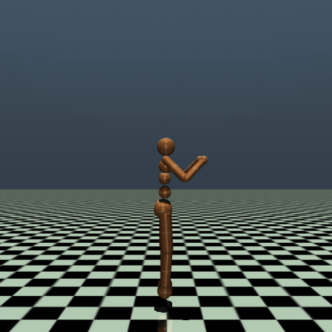
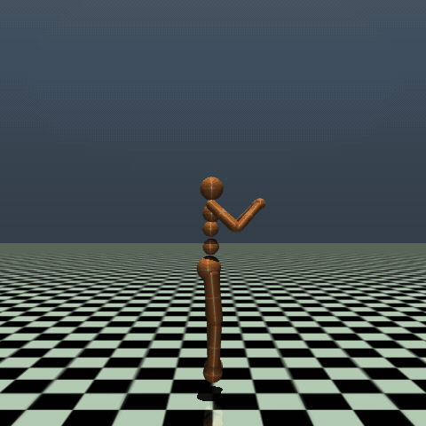
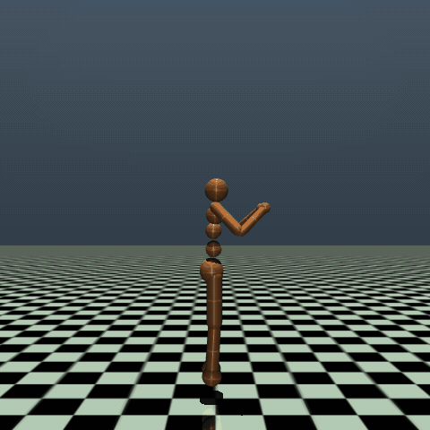
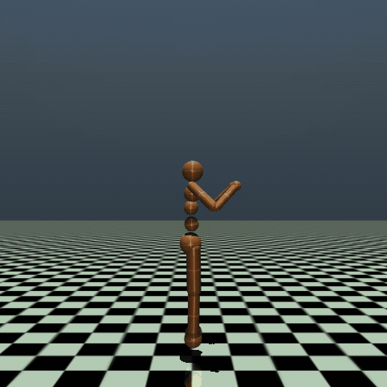
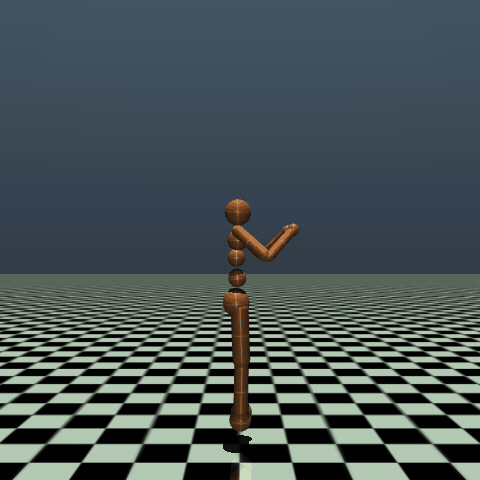
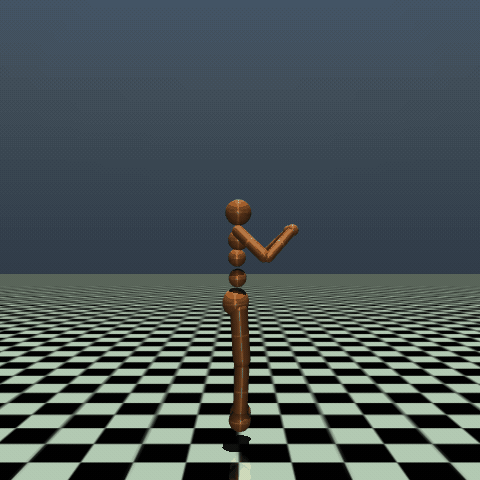
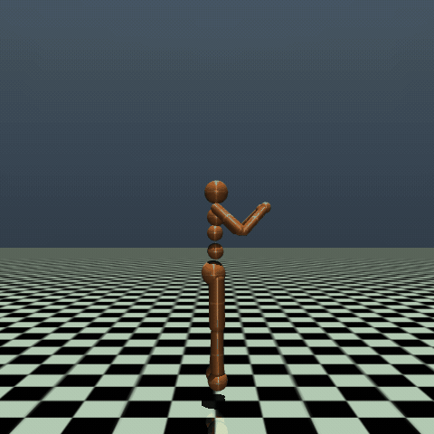
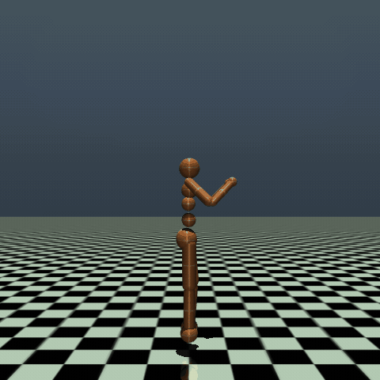
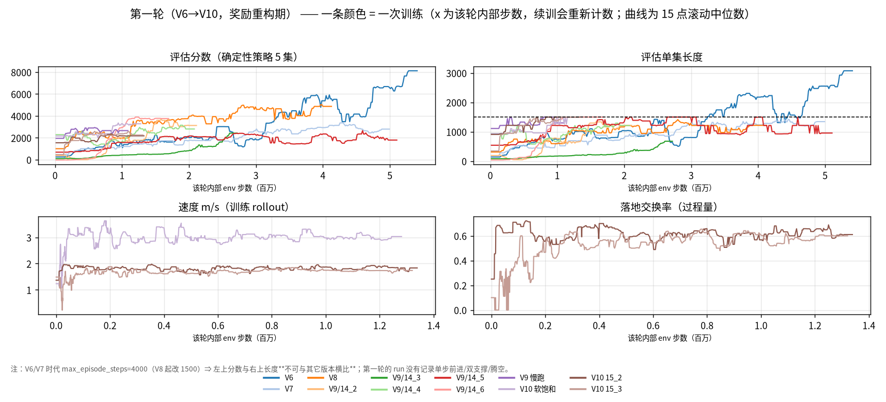
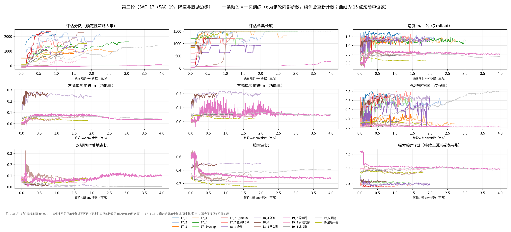

# humanoid_walk

用 SAC（Soft Actor-Critic）训练 MuJoCo `Humanoid-v4` 学习类人行走，目的是完整走一遍强化学习的训练流程：奖励设计、训练稳定性、评估口径与失败归因。本文记录整个过程，便于日后查阅。

训练分两轮：

- **第一轮（V1→V10）**：重构奖励，从单腿拖行到左右交替的小步幅慢跑，共训出两种步态。
- **第二轮（SAC_17→SAC_19）**：想把它改造成对称交替的步行。累计约 60 个 run（每个 run = 一次训练进程，对应一个 TensorBoard 事件目录）、数十次 1M-4M 步训练，最终训出三种步态，但没有实现理想的低速对称交替前行。

两轮合起来共五种步态形态，见「五种步态形态」；对应的录像在 `humanoid_walk_gif/`。

**速览**：[核心结论](#核心结论) · [成果演示](#成果演示) · [五种步态形态](#五种步态形态阶段性成果) · [项目进程](#项目进程) · [为什么低速对称交替迈步这么难](#为什么低速对称交替迈步这么难) · [训练稳定性](#训练稳定性两种死亡螺旋) · [奖励设计](#奖励设计当前) · [当前状态与下一步](#当前状态与下一步) · [训练 / 渲染](#训练--渲染) · [项目结构](#项目结构)

## 核心结论

**做到的部分**：左右交替的小步幅慢跑，速度 **1.73-1.78 m/s**、落地交换率（左右交替落地的比例）**0.60**（V10 终态两个 run；V9-V10 全部变体的范围是速度 1.73-3.00 m/s、落地交换率 0.60-0.64），满 1500 步不摔。另外有一条在单机 12 核 / 15 GiB 上能连续跑 **1.5M-4M 步不崩**的训练管线（两种死亡螺旋的机制已定位并处理）。

**没做到的部分**：低速下的对称交替迈步，也就是带双支撑（双脚同时着地的时长占比）的"真走"。第二轮把速度从 1.7 m/s 压到 **1.2-1.4 m/s**，步态仍是带腾空的跑（腾空占比 **0.46-0.51**），交替与推进也始终没有同时对称。障碍在装置层：

- 脚是半径 **0.075 m** 的球，`left_foot`/`right_foot` 两个 body 无关节，17 个执行器里也没有踝；
- 两个接触点在前后的连线宽度为 0，支撑多边形退化，不存在静态稳定域；
- 人类在支撑期靠踝关节（实测活动度 **28°**）微调重心，这台机器人没有这个自由度。

13 次改价（即修改奖励函数），加上接口、几何与辅助方向的多次尝试，都没能换来"把脚放到重心前方并稳住"这项能力。无辅助条件下，历史最好的触地超前量（落地瞬间脚在躯干前方的距离）只有 **0.065 m**（人体池化参考 **0.222 m**）；用硬伺服可以把它推到 **0.104 m**（膝）和 **0.152 m**（髋），但存活同时从 1500 帧跌到 **282 / 251 帧**。

> 全部为纯 RL 结果。动捕数据（LAFAN1 + CMU 池化 9 段）只用作对照常数，从未进入 obs、reward 或优化器。

---

## 成果演示

每种形态一段实录（确定性策略，上限 1500 步；1 步 = 1 个环境 step = 1 帧 = 15 ms，即 22.5 s），文件都在 `humanoid_walk_gif/`。

**第一轮**：单腿拖行 → 过渡（左腿开始摆但仍不交替）→ 左右交替小步幅慢跑

| 形态 1 · 右腿在前摆、左腿拖行（V6） | 过渡 · V8 | 形态 2 · 左右交替小步幅慢跑（V9-V10） |
|---|---|---|
|  |  |  |

**第二轮**：降速后交替崩塌 → 镜像增广后交替恢复但推进不对称 → 从头训落到原地踏步

| 形态 3 · 交替崩塌（17_3） | 形态 3 · 左腿步幅塌陷（17_6） | 形态 4 · 单腿包揽推进（SAC_18 末期） |
|---|---|---|
|  |  |  |

| 形态 5 · 原地踏步（19_4） | 形态 5 · 撅腚高速原地（19_5） |
|---|---|
|  |  |

### 训练曲线





横轴是训练步数，纵轴分别是各面板标注的评估分数与单步前进。第二轮那张要分两段看：**18_4/18_6 单步前进 0.18-0.26 m、速度 1.2-1.3 m/s（此时评估分数 800-2900）**；**18_8 起从头训，单步前进掉到 0.03-0.07 m，19_x 的评估分数却从 −26 回升到 1300+**。后一段才是"奖励在涨、功能没涨"，这也是本项目只用单步前进衡量成果的原因。

两张图每个面板底部都写明了那一轮缺哪些指标（缺的留空，不画成 0）。

> 图里的"落地交换率"取自 TensorBoard 的过程量（随机训练 rollout），与形态表里的确定性评估落地交换率不是同一把尺，数值可以差好几倍。

---

## 五种步态形态（阶段性成果）

| # | 形态 | 阶段 | 关键读数 | 阶段结论 |
|---|---|---|---|---|
| **1** | 右腿一直在前摆、左腿在后**拖行** | V4-V7 | V6 左/右单次腾空 **4.85 / 9.17 帧**（比值 0.53） | 单腿主导，左腿只起配重作用 |
| **2** | **左右交替小步幅慢跑** | V9-V10 | 速度 **1.73-3.00 m/s**、落地交换率 **0.60-0.64** | **唯一同时成立"交替 + 前进"的形态** |
| **3** | 右腿领先 + **左腿步幅塌陷** | 17_3→17_7 | 落地交换率 → **0**；左右落地步幅差 **4-7 倍** | 降速与交替互相拆台；惩罚有上限，过了就反噬 |
| **4** | 镜像增广后交替恢复、**推进仍不对称** | SAC_18 | 落地交换率 **0.52-0.71**；左右落地步幅仍差 **2.9-7 倍** | 降速到 **1.2-1.4 m/s** 后交替恢复，但仍带腾空、推进由右腿包揽 |
| **5** | 从头训 → **原地踏步 / 原地摆腿** | SAC_19 | 单步前进最高 **0.114 m**（人体 0.393） | 脱离旧局部最优的代价是丢掉前进 |
| — | **人体参考**（9 段池化） | — | 落地 **2.13/s**、双支撑占比 0.27、步长 **0.393 m**、触地超前量 **0.222 m**、踝活动度 **28°** | 本机踝活动度 0° |

形态内部还有六轮各自的变体（高频小碎步、剪刀式拖行、原地踏步交替、撅腚高速原地踏步、倒走等）。

看这张表要注意三点：

- **判断成果只看单步前进**，即脚实际向前移动了多远。
- **落地交换率和双支撑占比都可能"变好"而实际功能退步**：有一轮落地交换率涨到接近 1，单步前进却缩到原来的 1/3.3。
- **评估分数高不等于在走路**，得结合速度和步幅一起读。

---

## 项目进程

### 第一轮（V1→V10，奖励重构期）

归档在 `best_model_saved/round1/`，各版本目录下有当时的说明文件（如 `V6.txt`）。

- **V1-V3**：把策略拉出默认奖励下的"原地站立"局部最优。V3 加入了 forward/height/fall/survival/leg_activity/ctrl 六项。
- **V4-V7**：右腿一直在前摆，左腿在后拖行。
- **V8**：过渡。"半蹲、左脚朝右前方摆"，仍未交替前行，但原来拖在后面的左腿明显摆了起来。
- **V9-V10**：得到左右交替的小步幅慢跑（腾空比 0.88-1.20）。

> 这一轮走通了"站起来、迈开腿、左右交替"三步，但交替是靠高速度换来的，而且当时没有双支撑占比、腾空和落点的遥测。第二轮的工作几乎都围绕这个盲区展开。

### 第二轮（SAC_17 → SAC_19，共 17 轮改动）

归档在 `best_model_saved/round2/`，目标是降速并鼓励迈步，把慢跑改成走。这里的"轮"指一次奖励或训练配置改动。

- **17_3：交替开始崩塌**，落地交换率 0.679→0.261→0.048→0.000，速度也从 1.56 掉到 1.17 m/s（随机口径）。
- **17_6：右膝折叠加深**（该阶段后段 17_6_d / 17_7 到 −2.81 rad；但 18_6 也到 −2.77，不是这一阶段独有）。同一阶段"不交替"的惩罚加到 2.0/2.3 罚不动，2.5 直接把策略打崩（评估分数 **−26**、单集只活 **19 步**、跑到 3.19M 仍未恢复）。
- **相位对齐 + forward 门控**把落地交换率拉回 0.49-0.75，但左右落地步幅始终没有实质改善；膝深折惩罚同样无效。
- **SAC_18：镜像增广**。交替稳定下来、膝折略有回落（−2.81 → −2.62~−2.77），步幅差虽有收窄，但离对称仍很远，真正的对称交替前行始终没有出现。其中 `18_加重腾空惩罚` 那一轮的指标最极端：左右髋摆幅之比只有 0.09、双支撑占比 0.000、腾空占比 0.460。
- **SAC_19：从头训练**。为摆脱 load 旧模型的局部最优陷阱，改为从零开始。落地交换率掉到 0.065，步态变成原地踏步 / 原地摆腿，但第一次拿到真实的双支撑占比 **0.155** 和摆动对称性（左右髋摆幅之比）**0.75**。整段里落地交换率最高做到 **0.972**、髋摆幅比最高 **0.94**，不过这几项从未同时成立。
- **回头分析模型**：正是在解释"为什么原地踏步能拿高分、为什么双支撑占比不为 0 的集全都摔"的过程中，确认了无踝球足这条装置层限制。

---

## 为什么低速对称交替迈步这么难

### 原因：支撑面退化成一条线

模型里有三个字段直接决定了这件事：

```
body left_foot / right_foot : njoint = 0          ← 无踝
geom left_foot / right_foot : SPHERE, r = 0.075 m ← 球足
17 actuators，其中 ankle = 0
```

- **无踝**：人类在支撑期靠踝关节（实测活动度 28°）微调重心，本机没有这个自由度。
- **球足**：两个接触点在前后的连线宽度为 0，支撑多边形退化，不存在"站着不动也不倒"的姿势。
- **没有静态解**：只能像倒立摆一样被连续主动地稳住。

这解释了为什么"越慢越难"：高速跑时可以借动量把姿态带过去，低速走时每一步都近似一道静态平衡题，而本机没有静态解。

### 验证：五条证据指向同一件事

**1. 没有可维持的静态姿态**

17 个关节朝固定姿态做 PD，45 组增益（kp 最高 3200），没有一组站稳 1000 帧，执行器饱和 0.83-0.96。

**2. 球足几何买不到稳定裕度**

半径从 0.075 m 一路试到 0.165 m，倾角裕度只有 3.1-6.3°；r ≥ 0.135 m 时腿够不到地或自碰；想要人类约 10° 的裕度需要 r ≈ 0.17。

**3. 训练日志里，双支撑与存活从不同时出现**

315 次确定性评估中，双支撑占比超过 1% 的集**全部以摔倒告终**（平均寿命 91-431 步）；活满 1500 步的 293 集几乎恒为 0。新一轮 625 个集复核，**589 个存活集的读数恰好是 0.0000**。

**4. 写死摆腿的"形"可以，平衡不行**

这是唯一真正训过的"写死 + 学习"路线：摆动窗口内由时钟接管两条 `hip_y`，支撑期把控制权完整交回策略，从 19_1 起的所有训练都是这个接口。结果摆动对称做出来了（左右髋摆幅之比 0.08 → 0.90-0.94、抬脚高度 0.022 → 0.077-0.088 m），但没有换来对称前进——19_5 的落地交换率 0.972，单步前进反而缩到 1/3.3。

**5. 缺口在落脚位置：能迈出去，但落不到重心前方**

摆动脚落在哪里，看的是两件事：落地点在躯干前方多远，以及落地后能不能稳住。

- **最好的一次**：触地超前量只有 **0.065 m**（人体池化参考 0.222 m）。
- **强行送到 0.15 m**：脚是放到了，存活却从 1500 帧跌到 **251 帧**——放得出去，站不住。

> 早期还做过纯开环的周期轨迹搜索，以及在已训练策略上覆盖两条 `hip_y` 的 rollout：前者没有反馈、后者改变了策略训练时的动力学，摔倒不能归因于轨迹设计（也没有正对照），所以不作为判据。

### 结论：缺的是实时稳定能力，不是奖励项

在本机的几何条件下，低速对称交替迈步不是奖励没调对。13 次改价、探索与熵、状态注入、动作接口先验、几何放大都换不来。改起来最直接的是几何本身：

- **换平底**：只改 geom，观测与动作维度不变，可以从现有权重继续训。
- **加踝**：动作从 17 维变成 19 维、观测也变，只能从头训练。

下一步的方向见「当前状态与下一步」。

---

## 训练稳定性：两种死亡螺旋

warm-start 续训曾在 30 万到 120 万步之间反复崩溃：评估分数锁死在 −60、单集几十步就摔、且无法恢复。固定 seed 复现后定位出两条链：

| 类型 | 链条 | 解法 |
|---|---|---|
| **噪声漂移型** | 熵项把 `log_std` 从 0.21 推到 0.26 → 随机 rollout 全摔 → 摔倒数据进入 buffer → critic 逐渐认为"摔很正常" → 均值策略退化 | 给 actor 的 `log_std` 加 forward-hook 上限（std ≤ 0.22），clamp 边界处熵梯度为零。**只在续训时启用**：从头训练的初始 std ≈ 1，clamp 会掐死探索 |
| **critic 失配型** | 改奖励 → 最优策略漂移 → critic 仍在拟合旧数据 → 系统性高估 → actor 追着错误的 Q 走 | **奖励地板填谷**：提高移动门控下的 `height`/`survival`，让过渡期的收入不至于深负 |

seed=42 复现实验：不加 clamp 在约 300K 崩，加 clamp 推迟到约 500K，再加填谷后 **1.5M 全程稳定**。

> 经验：warm-start 与改奖励同时使用，等于把 critic 失配的风险叠加到续训上，改完奖励后从零训练会更稳。另外两条容易误判：
> - 续训只 `load_state_dict`，`num_timesteps` 会归零，学习率随之从 2e-4 重启；
> - 学习率退火读的是剩余进度，所以从头训练若只给 2M 预算，可能在找到可行步态之前就被学习率锁死（后来统一改 4M）。

---

## 奖励设计（当前）

`WalkRewardWrapper`（在 `train_humanoid_sac.py` 里）把"像人一样走路"拆成 20 多个可观测的量，每帧结算一次。设计分三层：**推进收入**给方向，**步态形状**给时序与对称，**门控**决定这些收入能不能被拿到。项目里出问题的地方几乎都在第三层。

| 类别 | 项（权重） | 计量方式 |
|---|---|---|
| **推进** | `forward_gauss` ×0.4（峰 **0.95 m/s**、σ 0.28）− 超速税 1.0×max(0, v−1.6) | 躯干前进速度；再乘 `forward_gate` + `walk_gate`（见下） |
| **放置（落脚位置）** | `place_reward` ×3.0/帧 | `clip((脚x − 躯干x + 0.06)/0.26) × 是否支撑`，左右腿各一份，逐帧累计（与时间成正比，不与落地次数成正比） |
| **步幅 / 交替** | `stride_bonus` **35 分/落地**（两脚间距 0.10→0.20 斜坡，且要求真实交换）；`position_swap` ×1.0；`alternate_penalty` ×2.3 | 间距与交换在**落地帧**结算；`position_swap` 是稠密的相位对齐（周期 60 帧） |
| **摆动** | `swing_min` ×2.0、`reach` ×2.0、`swing_forward`、`contact_phase` | 摆动期的髋前摆量与落点；后两项要求另一只脚正支撑 |
| **姿态** | `net_balance` 0.1 − pitch − roll；`lateral` ×0.1；`hip_xz`；`support_sym` ×2.0；`activity_diff` ×0.5 | 躯干俯仰、横滚、横移，以及左右支撑时间与活跃度差 |
| **生存** | `height` ×1.0（躯干高度平顶带 1.25-1.45）、`survival` 0.5/帧、`fall_penalty` **−50**、`ctrl_cost` ×0.005 | 摔倒即终止并扣 50 |
| **税** | `flight_time_penalty` ×0.60/帧（抑制腾空）、`short_stride` ×7.0、`tiny_step` ×0.30/帧、`negative_stride` ×3.0、`slip` ×0.3（自由区 0.10 m/s） | 腾空、碎步、后撤、拖滑各自收税 |

门控分别乘在不同的项上，用来关掉"不走路也能拿钱"的通道：

- `forward_gate`（左右较小步幅 / 0.15 m，截断到 0-1）：推进收入的第一道对称门。
- `walk_gate`（地板 0.20，单支撑门）：推进收入、`swing_min`、`position_swap`，以及交替奖的那一侧；`stride_bonus` 不乘它。
- `flat_gate`（地板 0.6）+ `_dense_ds_factor`（参考值 0.25、地板 0.55）：`height` 与 `survival`；`position_swap` 另乘一道 `_dense_ds_factor`。
- `swap_gate`：`reach`。
- `_speed_ramp = clip((v−0.10)/0.20)`：`height`、`survival` 与碎步税共用，站着不动时这些项为 0。

`phase_reward`（要求两髋反相）在最新一版里只记录、不结算，因为它可以靠折腰加空摆髋满足，与是否前进无关。旧版本里它是参与结算的，具体见各轮的备份脚本。

**动作接口不算奖励项**：摆动窗口内由时钟接管两腿的 `hip_y`，注入 `−A·sin(πu)`（A=0.15，右腿偏移半周期），支撑期把控制权完整交回策略。注意 buffer 里存的是策略的原始动作，物理看到的是改写后的动作，所以引入摆腿时钟模板（`osc_enable=True`）之后训练出的策略必须与同一份模板一起部署和评估，否则看到的是没人驱动摆腿的被动轨迹。

三条被反复验证的原则：

- **按事件付钱，收入就与频率成正比**：轻点地面的收入约是真迈步的 2.7 倍，所以要么按帧（与时间成正比）付，要么按米付。
- **罚项不能乘质量门**，否则步态越差罚得越轻；**过程量必须挂在结果上**：剪刀式拖行曾靠"两髋反相加每腿独立前伸"额外拿到 +71 分/集，而罚不交替只收到 −26，净补贴 +45。
- **门槛必须低于实测中位数**，否则该通道付的恰好是 0。"权重很小"和"权重为零"在效果上没有区别。加门控前要先算这个观测量在当前解和目标解上的值；两边都越过斜坡顶端的门起不到约束作用。

---

## 当前状态与下一步

**现状**：最近一轮训练评估为 **FAIL**。它学会的是**倒着走**——放置通道 `place_reward` 按帧付"脚在躯干前方且正在支撑"，这项条件不需要前进就能满足。13 次改价把单步前进的最高值做到 **0.114 m**（判据线 0.13 m），停下时是 0.028 / 0.009 且一直在降。奖励这条路到此为止，不再加项。

**手里的资产**：形态 2（V9-V10 的左右交替小步幅慢跑，1.73-1.78 m/s、落地交换率 0.60、满 1500 步），以及那条 4M 步不崩的训练管线。

**几个方向**（顺序、成本、判据等真要做时再定，下面这些判断都可能被下一次测量推翻）：

- **下一轮：做减法**。目标从"像人一样走"改成**对称交替地向前**；删掉腾空税、双支撑因子与摆动侧的代理量，关掉摆腿时钟模板（现状是只有 **0.2%** 的收入花在前进上，腾空税却收走 **12%**）。
- **动捕数据做模仿学习**：开环重放我们试过的参数族没有存活（离线筛查：600 组/档 × 3 档，不构成对开环重放本身的否证），没试过的是**闭环跟踪**（DeepMimic 式），而且要跟任务级的量（步频、落脚点、占空比）而不是人类关节角，因为人类那 0.222 m 的触地超前量是踝换来的。
- **换模型**，两条路可选：
  - **换平底**（优先）：只改 geom，观测与动作维度不变，可以直接续训。我们测过的只是"更大的球"，**有面积的底从没测过**。
  - **加踝**：动作从 17 维变成 19 维、观测也变，只能从头训练。
- **外力辅助 / 减重从头训**：既没被支持也没被否证。之前是把助力加在没用辅助训过的权重上，那种测法按构造无效。

---

## 训练 / 渲染

依赖固定在 `requirements.txt`：先按自己的硬件装好 torch（本项目是 CPU 构建），再 `pip install -r requirements.txt`。

```bash
python3 train_humanoid_sac.py                    # 8 并行训练环境 + 1 独立评估环境
tensorboard --logdir ./sac_humanoid_walk         # 认 run 要看事件文件名里的 PID，目录名会被复用
python3 debug_probes/summarize_gait_stages.py    # 把各阶段归档的步态指标压成一张表
```

渲染和导 GIF 都用 `test_humanoid.py`。改掉 `MODEL_PATH` 后，只剩两步：

1. **选环境接口**（脚本里五组，按权重所属世代取消注释）：
   - era-1（V*）与 17_x：裸环境；
   - 18_x（含 18_8）：只加 `patch_mirror_symmetry`；
   - 19_1：patch + 当前 `WalkRewardWrapper(..., osc_enable=True)`，但训练时摆幅是 **A=0.25**，构造后要补 `env.osc_A = 0.25`；
   - 19_2 / 19_3 / 19_4：patch + 同一个 wrapper（T1，摆幅 A=0.15；19_3 无归档源码，按同系列推定）；
   - 19_5：patch + 它归档源码里的 T2 版本。
2. **选模式**：`EXPORT_GIF=False` 开窗口（摔倒或到 1500 步自动重置，每集打印长度与 reward）；改成 `True` 录一段 GIF，同时把 `GIF_PATH` 换成新名字，避免覆盖 README 的素材。

> 19_1 起策略是和摆腿时钟模板一起训出来的。裸环境里没人驱动摆腿，看着会比训练时明显差。

各阶段的权重在 `best_model_saved/round1/`（第一轮 V1-V10）与 `best_model_saved/round2/`（第二轮，按 `17_*` / `SAC_18/*` / `SAC_19/*` 分阶段），每个归档目录里都有一份 `best_model.zip`。

---

## 项目结构

```
humanoid_walk/
├── train_humanoid_sac.py               # 主训练脚本（WalkRewardWrapper + 摆腿时钟模板 + 回调 + 稳定性工程）
├── test_humanoid.py                    # 渲染脚本：按权重世代选环境接口；EXPORT_GIF 切换开窗口 / 录 GIF
├── mirror_map.py                       # 左右镜像映射（几何金标准由 debug_probes/build_mirror_map.py 生成）
├── requirements.txt                    # 训练与工具链的固定版本（torch 需按硬件自行先装）
├── debug_probes/                       # 只读探针：形态表 summarize_gait_stages.py、曲线 export_curves.py、
│                                       #   各轮判据脚本、离线可行性实验、定价表、GIF 修补 gif_loop_fix.py / gif_trim.py
│   └── mocap/                          # 动捕参考语料（CMU BVH）+ 统计脚本与 pooled_*.txt
├── best_model/                         # 当前这一轮的产物：best_model.zip + snapshots + best_extra_logs.jsonl
│                                       #   ⚠ 会被下一次训练覆盖，要留的权重请拷进 best_model_saved/
├── best_model_saved/
│   ├── round1/                         # 第一轮归档（每个版本目录含当时的 best_model.zip + 说明 txt）
│   └── round2/                         # 第二轮归档：17_1…17_7、SAC_18/*、SAC_19/*（权重 + 当时源码 + 日志）
├── humanoid_walk_gif/                  # README 引用的 8 段步态实录
├── docs/                               # 训练曲线 curve_round1.png / curve_round2.png
├── eval_logs/                          # evaluations.npz + eval_gait.jsonl（追加式，无 step/run 字段）
├── sac_humanoid_walk/                  # TensorBoard 日志（目录名会被复用，认 run 要看文件名里的 PID）
├── history/                            # 历史遗留：早期 PPO 脚本与日志、各轮源码快照、旧版 README
│                                       #   不保证能直接运行；文件清单见 history/INDEX.md
├── CONTEXT_HANDOFF.md                  # 滚动交接文档：内部逐轮记录（改动、判据、结果与被推翻的结论），首次读项目可跳过
└── README.md
```
